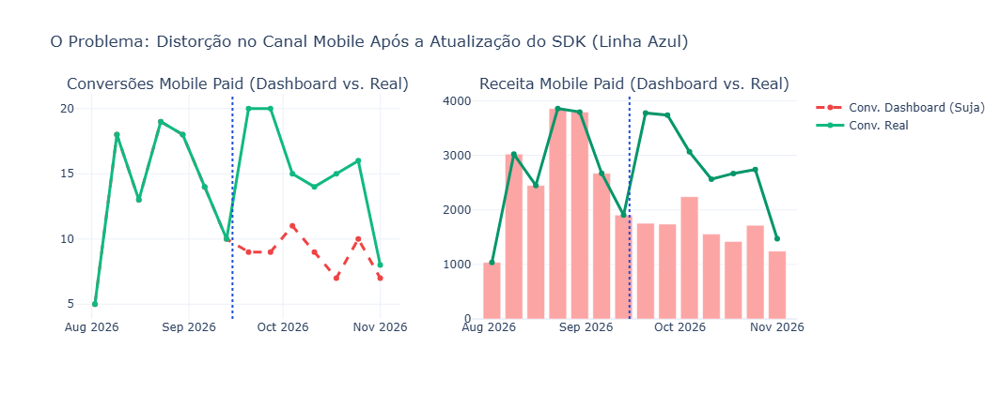
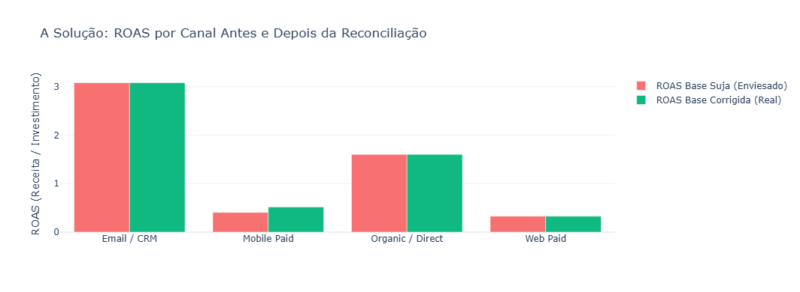

# Auditoria Mobile e Alocação de Orçamento de Marketing (CRISP-DM)

Projeto prático em **Python** e **Marimo** que simula e audita uma discrepância de dados entre um *dashboard* de marketing e os registros reais após uma atualização de SDK/rastreamento *mobile*, aplicando a metodologia **CRISP-DM** e a estrutura **STAR** para apoiar decisões de orçamento.

## Cenário e Problema de Negócio (STAR)

* **Situação:** Durante o planejamento da alocação de orçamento de marketing para o próximo trimestre, os números de conversão exibidos no *dashboard* divergiram dos registros analíticos subjacentes.

* **Tarefa:** Avaliar o desempenho real por canal (*Mobile Paid*, *Web Paid*, *Organic / Direct* e *Email / CRM*) para recomendar a distribuição de verba do próximo trimestre com base em métricas confiáveis de **ROAS** e **CPA**.

* **Ação:** Em vez de aplicar ajustes manuais isolados na planilha apenas para acelerar a entrega, o fluxo foi dividido em etapas auditáveis no Marimo: diagnóstico de valores ausentes e falhas de *join* (chaves nulas e órfãs), tratamento cauteloso de custos ausentes, investigação da causa raiz (quebra de rastreamento/atribuição após atualização *mobile*) para correção na origem com a engenharia de dados, documentação da discrepância e testes automatizados de qualidade de dados.

* **Resultado:** Mesmo com a etapa adicional de investigação e validação, a correção evitou subestimar o canal *mobile* e revelou que as campanhas para celular tinham um retorno muito maior do que parecia no painel — orientando uma alocação de orçamento mais precisa e deixando o processo documentado para o time.

## O Problema vs. A Solução

### 1. O Problema: Queda Artificial no Canal Mobile Após Atualização do SDK
Após a data da atualização do SDK/rastreamento *mobile* (linha tracejada azul), o painel passa a subestimar conversões e receita do canal *Mobile Paid*, além de concentrar chaves de *join* ausentes/órfãs.



### 2. A Solução: Reconciliação na Origem e Leitura Real do ROAS
Com a auditoria de *joins*, tratamento de nulos e reconciliação dos dados na fonte, o ROAS do canal *Mobile Paid* deixa de ser subestimado e passa a refletir seu retorno real na comparação entre canais.



## Etapas no Notebook (`auditor_mobile_crisp_dm.py`)

1. **Business Understanding:** Controles interativos de orçamento total e taxa de quebra do SDK *mobile*.

2. **Data Understanding:** Simulação da base real vs. base suja do *dashboard*, auditoria de nulos e *joins*, e visualização gráfica da discrepância.

3. **Data Preparation:** Imputação de custos ausentes por mediana do canal, classificação de status de *join* (`OK`, `MISSING_KEY (NULL)`, `ORPHAN_JOIN_KEY`) e reconciliação na origem.

4. **Data Quality Gates (Testes Automatizados):** Verificações de unicidade de `event_id`, completude de `spend_clean`, conversões não negativas e coerência entre conversão e receita.

5. **Modeling & Evaluation:** Comparação de conversões, ROAS e CPA antes e depois da correção.

6. **Deployment:** Simulação de alocação orçamentária para o próximo trimestre e registro de governança/documentação.

## Como Executar Localmente

```bash
pip install marimo pandas numpy plotly
marimo edit auditoria_atribuicao_mobile_crisp_dm.py
